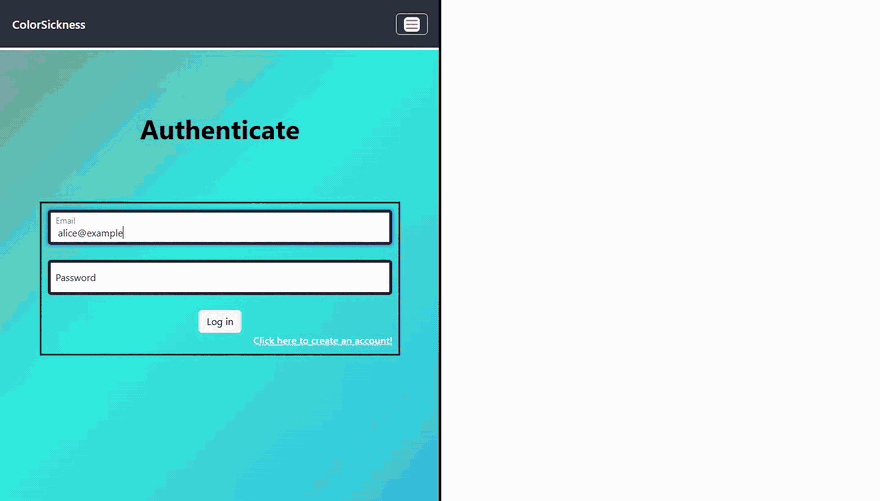
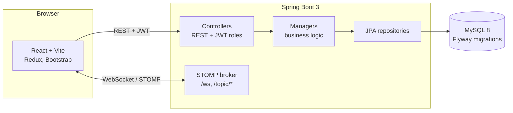
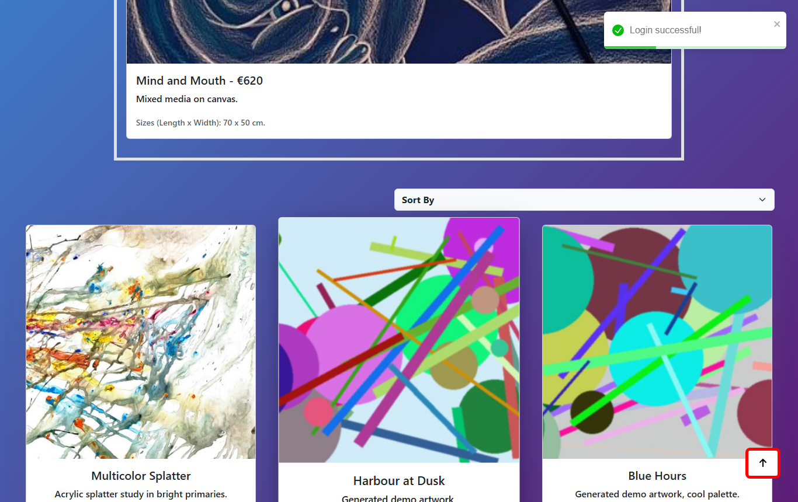
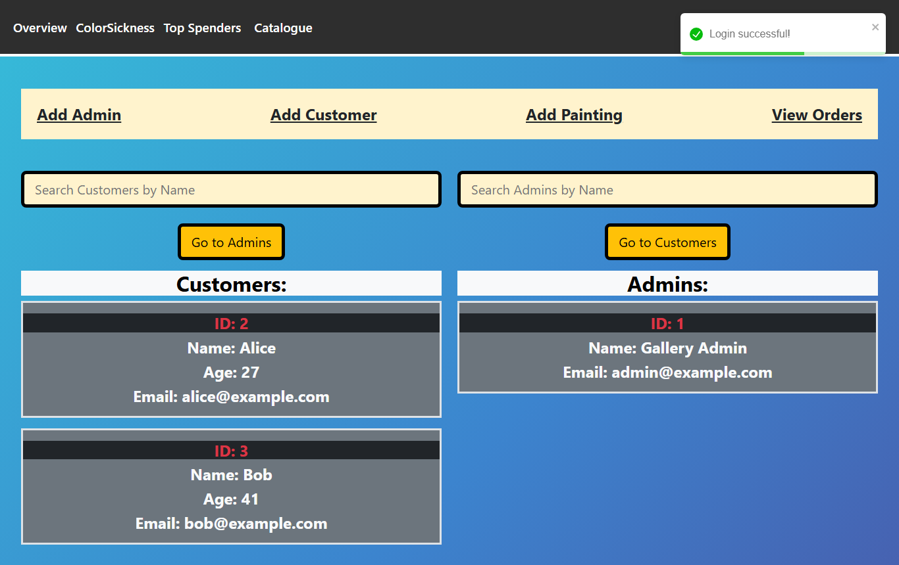

# ColorSickness: online painting shop with live auctions

A full-stack web shop for paintings: customers browse a catalogue, buy paintings and bid in a live auction that updates in real time for everyone watching. Admins manage paintings, customers, admins and orders, start and end auctions, and see a "top spenders" overview.



> Left: Alice. Right: Bob. Two separate browser sessions on the same live auction. Every bid appears in the other window without a page refresh (WebSockets). Demo accounts and demo data.

Individual project from my third semester of software engineering (Sep 2023 to Jan 2024).

## The problem

The assignment was an individual full-stack application with a real backend, a database, authentication, tests and CI. I picked an art gallery that sells paintings, and added a live auction because I wanted to learn real-time communication: a normal REST request/response is not enough when many people bid on the same painting at once and all of them need to see the new highest bid immediately.

## What it does

**Customers**
- register and log in
- browse the catalogue, sort it and open a painting's details
- buy a painting (creates an order)
- join the live auction: place bids and see other people's bids appear instantly; the highest bidder can buy the painting when the auction ends
- edit their profile

**Admins**
- add, edit and delete paintings (with image upload), customers and admins
- start an auction for a painting and end it
- view and update orders (order status)
- "Top spenders": customers ranked by the total amount they spent

**Live auction, how it works:** the backend runs a STOMP message broker over WebSockets (Spring `@EnableWebSocketMessageBroker`, endpoint `/ws`). Every browser on the auction page subscribes to `/topic/place_bid` and `/topic/end_auction`. A bid is published to the topic (so all viewers update at once) and saved through the REST API (`PUT /auctions/{id}`), so the highest bid survives a page reload. There is also a support chat page that uses the same broker (`/topic/support_message`).

## Architecture



- **Backend layers:** controllers (request/response DTOs, validation, `@RolesAllowed` for ADMIN/CUSTOMER), managers (business rules behind interfaces), persistence (Spring Data JPA entities and repositories), converters between them.
- **Security:** Spring Security with a stateless JWT filter; passwords hashed with BCrypt; roles in the token decide which endpoints a user can call.
- **Database:** MySQL 8, schema versioned with 10 Flyway migrations.
- **Tests and CI:** unit tests for the managers with JUnit 5 and Mockito; a GitLab CI pipeline (build, test, SonarQube analysis) ran on the university's GitLab.

| Catalogue | Live auction | Admin dashboard |
|---|---|---|
|  |  |  |

## Tech stack

Java 17, Spring Boot 3.1 (Web, Data JPA, Security, Validation, WebSocket/STOMP), JWT (jjwt), Flyway, MySQL 8, Lombok, JUnit 5, Mockito, Gradle · React 18, Vite, Redux Toolkit, React Router, Axios, `@stomp/stompjs`, Bootstrap · Docker (backend image), GitLab CI, SonarQube.

## How to run it

Requirements: JDK 17, Node 18+, Docker (for MySQL).

```bash
# 1. Database
docker run -d --name colorsickness-db -p 3306:3306 \
  -e MYSQL_ROOT_PASSWORD=<choose-a-password> -e MYSQL_DATABASE=colorsickness mysql:8.0

# 2. Backend (http://localhost:8080). Secrets come from environment variables:
#    JWT_SECRET must be Base64 and at least 32 bytes when decoded.
cd backend
SPRING_DATASOURCE_PASSWORD=<same-password> JWT_SECRET=<base64-secret> ./gradlew bootRun

# 3. Frontend (http://localhost:5173)
cd frontend
npm install
npm run dev
```

Flyway creates the tables on the first start. Customers can register in the app. There is no sign-up for admins: to get the first admin, register a normal account and move it to the `admin` table, for example:

```sql
INSERT INTO admin (name, email, password) SELECT name, email, password FROM customer WHERE email = 'you@example.com';
DELETE FROM customer WHERE email = 'you@example.com';
```

The values in `application.properties` are placeholders; the real ones go in environment variables as above. The GIF and screenshots were recorded this way, with the code unchanged.

## My contribution

Individual project: I wrote the backend and the frontend. The original repositories (university GitLab) have 64 backend and 57 frontend commits, all mine. This repository starts with a fresh history.

**About this repository:** the code is mine and has not been changed since January 2024. I packaged it for GitHub (this README, screenshots, demo GIF, removing secrets) with help from an AI assistant, which is why the single commit lists Claude as co-author.

## Status and limitations

This is a semester project, not a product.
- **Bids are checked in the browser only.** The "higher than the current bid" rule runs in React; the browser publishes the bid straight to the STOMP topic and saves it with a separate REST call. The server does not validate bids, so a modified client could send any value.
- The WebSocket endpoint has no authentication; only one auction can be live at a time; an admin ends it manually.
- Images are stored as `LONGBLOB` in MySQL and sent as JSON byte arrays, which is heavy.
- URLs (`localhost:8080`, `localhost:5173`) are hard-coded in the frontend and in CORS settings.
- **Tests:** there are 38 manager unit tests, but `useJUnitPlatform()` is commented out in `build.gradle`, so `./gradlew test` runs none of them. With JUnit 5 enabled, 37 pass and 1 fails (`AuctionManagerImplTest.createAuction_Success`, a mock that returns no id).
- The GitLab CI and SonarQube setup pointed to university infrastructure and does not run on GitHub.

## What I would change for production

- Move bidding to the server: a `@MessageMapping` handler that validates the bid against the database in a transaction, then broadcasts it. Clients never publish to topics directly.
- Authenticate the WebSocket connection with the same JWT.
- Store images in object storage (S3 or similar) and keep only URLs in the database.
- Configuration per environment (URLs, CORS) instead of hard-coded `localhost`.
- Re-enable JUnit 5 in the build, fix the failing test, add integration tests for the auction flow, and run them on GitHub Actions.
- Scheduled auction end times instead of a manual end.
